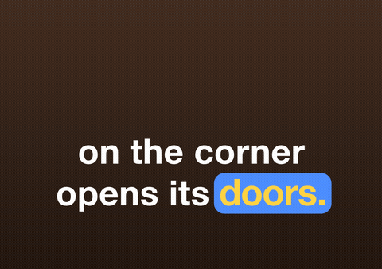
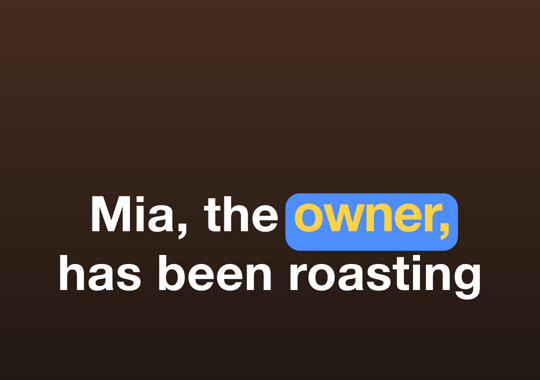
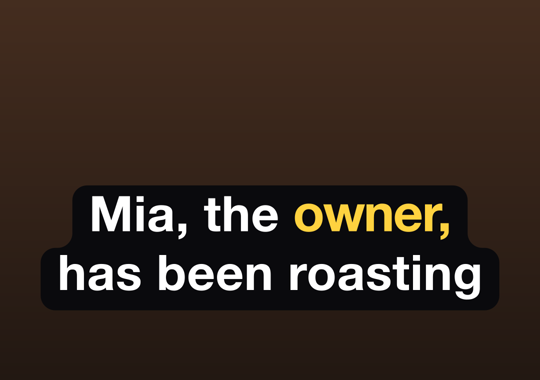
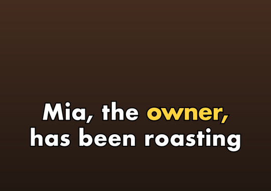
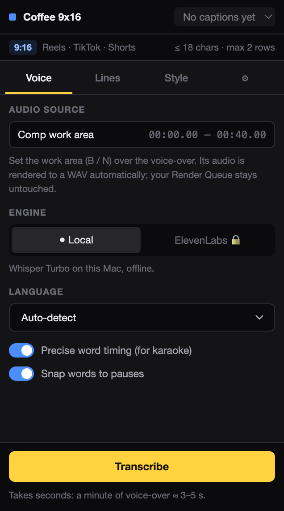
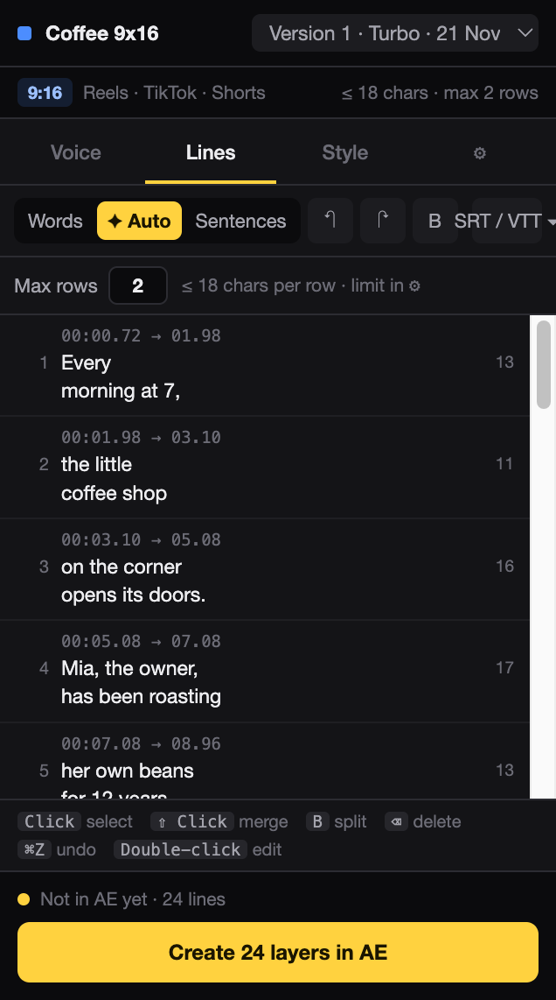
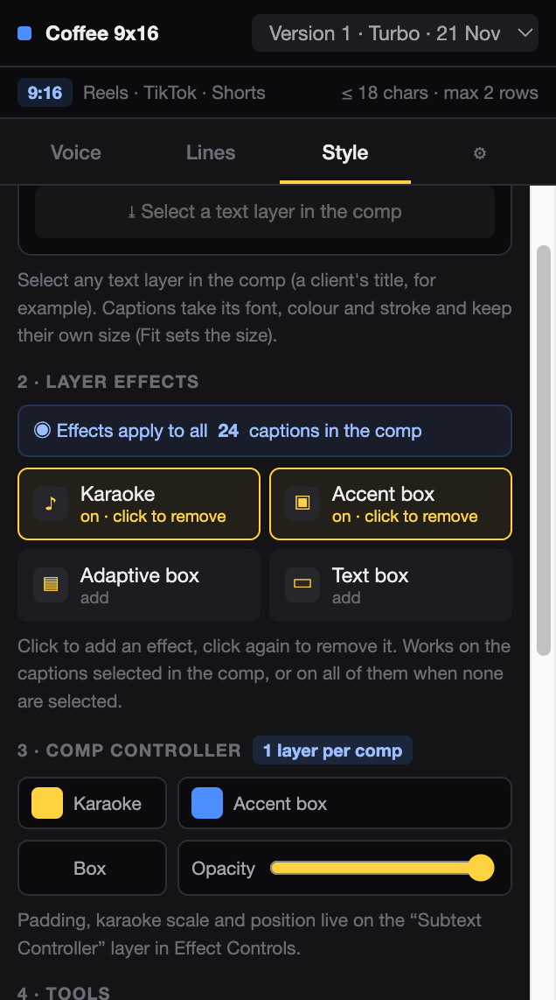
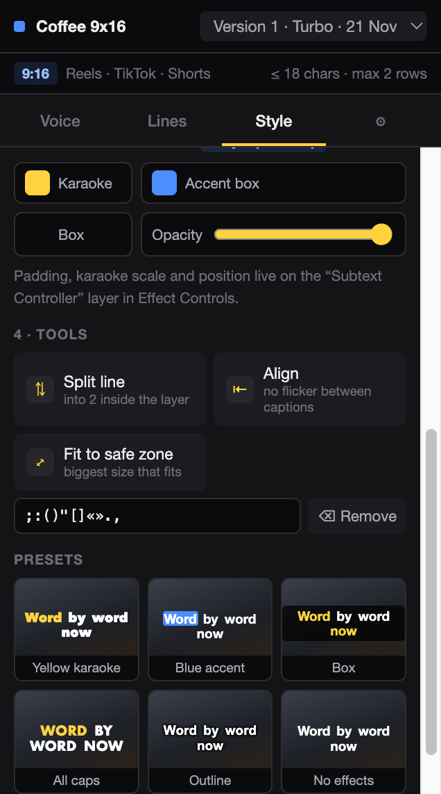
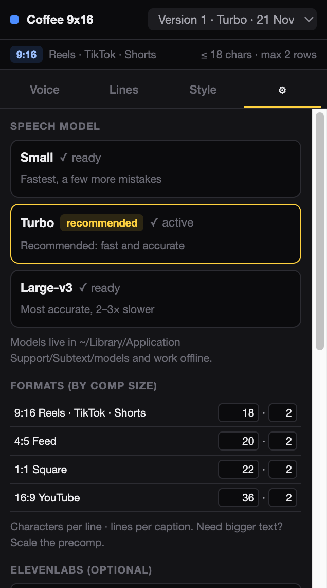

# Subtext — auto captions for After Effects

Subtext is a free panel for Adobe After Effects that turns a voice-over into ready-to-edit caption layers.
It listens to the audio in your comp, splits the speech into short captions sized for the format
(Reels, Feed, Square, YouTube) and builds real text layers with karaoke and box effects that you can restyle like
any other layer.

Speech recognition runs **on your Mac, offline** (Whisper). No account, no upload, no subscription.



| Blue accent | Box | Outline |
|---|---|---|
|  |  |  |

## Install

**Requirements:** a Mac with Apple Silicon (M1 or newer), After Effects 2023 or newer, about 2 GB of free space.

1. Download **Subtext-x.y.z.dmg** from [Releases](https://github.com/davishev11/subtext/releases/latest) and open it.
2. Quit After Effects.
3. Drag the **Subtext** folder onto **Drag Subtext here**. macOS asks for your Mac password once.
4. Open After Effects → **Window → Extensions → Subtext**.
5. On first launch, pick a speech model in ⚙ (Turbo is recommended, ≈1.5 GB, downloaded once).

To update, drag the new version the same way and choose **Replace**. To remove Subtext, delete
`/Library/Application Support/Adobe/CEP/extensions/Subtext`.

## How it works

1. **Voice:** set the comp's work area over the voice-over and press **Transcribe**. Subtext renders the
   work-area audio by itself (your Render Queue is untouched) and recognises every word with its timing.
2. **Lines:** the words are grouped into captions that fit the format's safe zone. Check and fix them in the
   list, then press **Create layers in AE**.
3. **Style:** pick a preset or copy the look of any text layer, then add karaoke and box effects.

Every caption is a normal text layer. One **Subtext Controller** null per comp holds the shared position, colours
and padding, so a change there updates all captions at once. Your edits, versions and settings are saved inside the
`.aep` file, so nothing extra has to travel with the project.

## The panel

### Voice



- **Audio source**: the comp's work area. Set it with **B / N** over the part you want captioned.
  Transcribing only part of the comp replaces only the captions inside that range.
- **Engine**: **Local** (Whisper on your Mac, offline). **ElevenLabs** is optional and needs your own API key in ⚙.
- **Language**: auto-detect, or choose one when the voice-over mixes languages.
- **Precise word timing**: exact word starts, for karaoke and the accent box.
- **Snap words to pauses**: ends a word where the speaker actually stops.
- **Transcribe**: about 3–5 seconds per minute of voice-over.

<br clear="right">

### Lines



- **Words / Auto / Sentences**: how speech is grouped. The highlighted button is the current mode.
  - **Words**: one word per caption.
  - **Auto**: short captions that fill the rows and break at natural pauses.
  - **Sentences**: one sentence per caption when it fits, otherwise split at commas.
- **Max rows**: how many rows a caption may have in this comp (any number). Captions keep a shared bottom line, and
  extra rows grow upwards.
- **↶ ↷**: undo and redo (⌘Z / ⌘⇧Z).
- **B**: split the selected caption in two.
- **SRT / VTT**: import or export subtitles.
- **In the list**:
  - Click a caption to select it. The playhead jumps to it in AE.
  - ⇧-click another caption to merge everything between the two.
  - Double-click to edit the text. ⌫ deletes the caption.
- **Create layers in AE / Update in AE**: builds the layers, or updates only the captions you changed.
- **Version list** (top right): every transcription is kept as a version, so you can go back to an older one.

<br clear="right">

### Style



- **Copy style from the selected layer**: select any text layer in the comp, a client's title for example.
  Captions take its font, colour and stroke and keep their own size.
- **Layer effects**: click to add, click again to remove. They work on the captions selected in the comp, or on all
  of them when none are selected.
  - **Karaoke**: the spoken word changes colour.
  - **Accent box**: a box moves behind the spoken word.
  - **Adaptive box**: a box that hugs each row.
  - **Text box**: one rectangle behind the whole caption.
- **Comp controller**: karaoke, accent and box colours and box opacity for the whole comp. Padding, karaoke scale
  and position are on the **Subtext Controller** layer in Effect Controls.

<br clear="right">



- **Split line**: breaks a one-row caption into two balanced rows inside the same layer.
- **Align**: closes the gaps between captions so nothing flickers.
- **Fit to safe zone**: the biggest size that keeps every caption inside the safe zone. Differences you made on
  purpose are kept: a caption you made bigger stays bigger.
- **Remove**: strips the listed characters (punctuation, for example) from the captions.
- **Presets**: font, effects and colours in one click. With captions selected in the comp, a preset changes only
  those.

<br clear="right">

### Settings ⚙



- **Speech model**:
  - **Small**: fastest.
  - **Turbo**: recommended.
  - **Large-v3**: most accurate, 2–3× slower.

  Models work offline and are stored in `~/Library/Application Support/Subtext/models`.
- **Formats**: characters per row and rows per caption for each comp shape (9:16, 4:5, 1:1, 16:9).
- **ElevenLabs** (optional): your API key. It is stored only on this Mac.
- **Storage**: where temporary audio goes, cache sizes, and cleaning up old versions.

<br clear="right">

## Working in After Effects

- **Move all captions**: move the **Subtext Controller** null, or change its *Caption Position*.
- **Move or scale one caption**: drag it or scale it as usual. Its own offset is kept through Update and Fit.
- **Duplicate a caption (⌘D)**: the copy becomes your own text layer. Subtext never changes it.
- **Other layers**: titles, precomps, shapes, adjustment layers and anything else that is not a caption are never
  touched.
- **Edit text in AE**: Subtext picks up text you typed directly into a caption layer.

## Build from source

```bash
scripts/build.sh          # signed extension + dist/Subtext-<version>.dmg
scripts/test.sh           # logic + After Effects tests
scripts/test.sh full      # + the panel clicked like a person, with a real transcription
```

The build needs a static arm64 `whisper-cli` from [whisper.cpp](https://github.com/ggerganov/whisper.cpp) and
Adobe's `ZXPSignCmd` with a certificate. See the variables at the top of `scripts/build.sh`. Tests are described in
[tests/README.md](tests/README.md).

## Credits

Made by Daria Shevchenko, a motion designer from Kyiv.
Speech recognition: [whisper.cpp](https://github.com/ggerganov/whisper.cpp) (MIT) with OpenAI Whisper models (MIT).

## License

[MIT](LICENSE)
